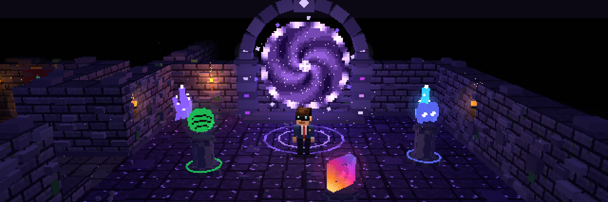
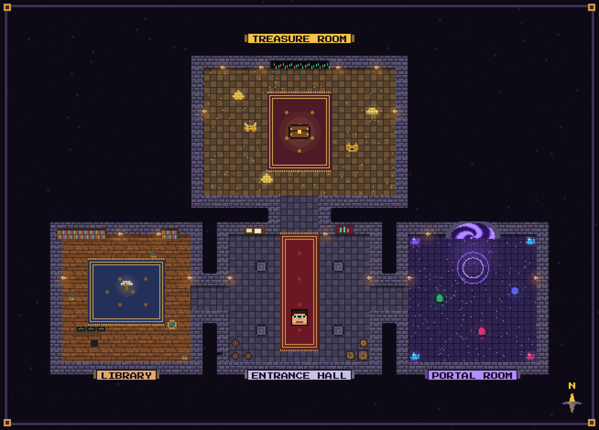
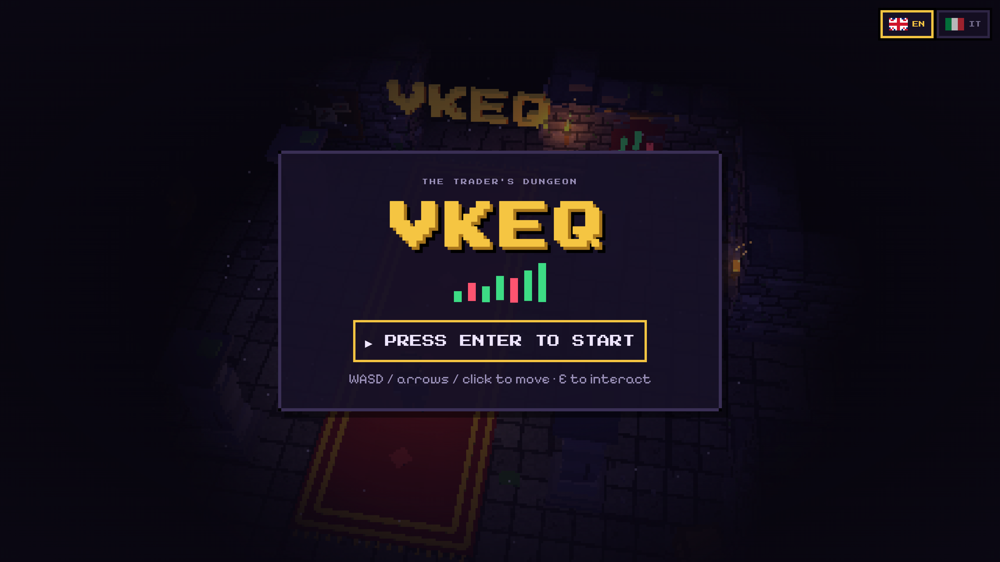
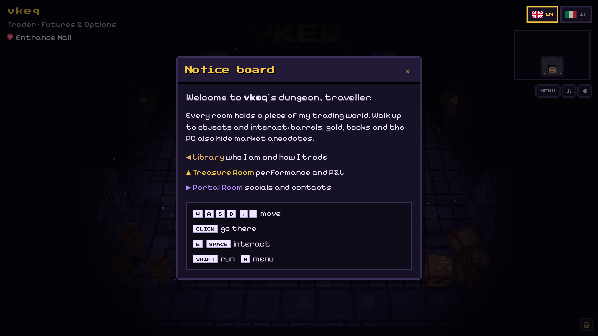
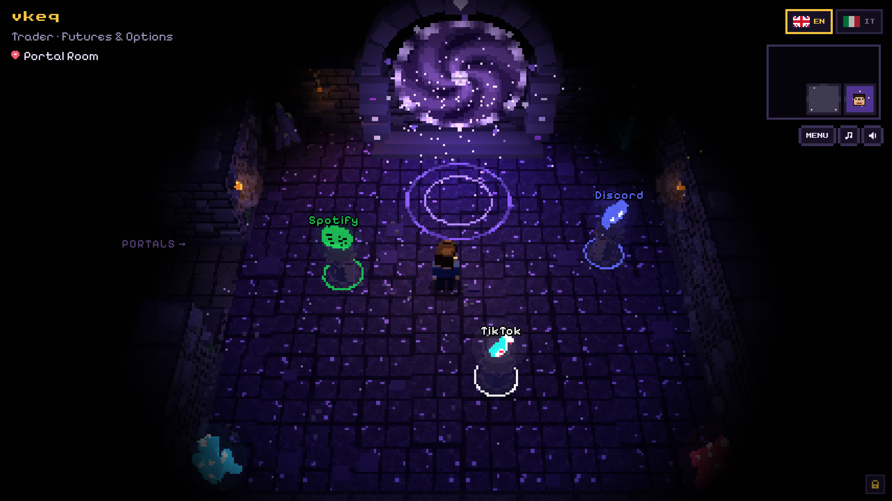
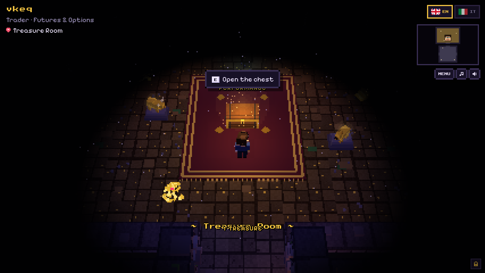
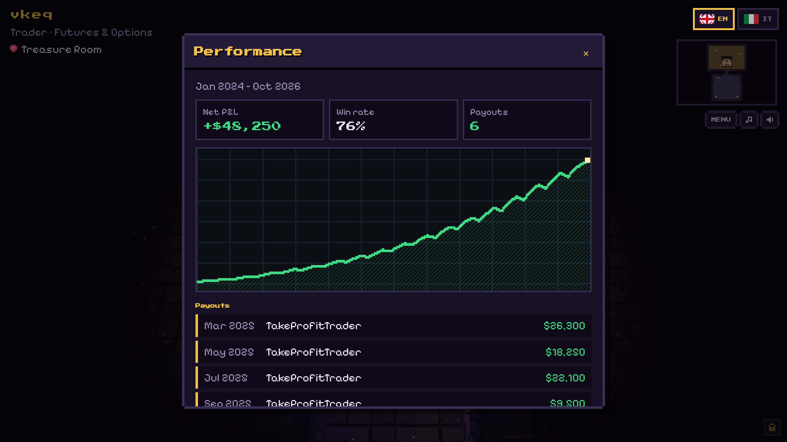
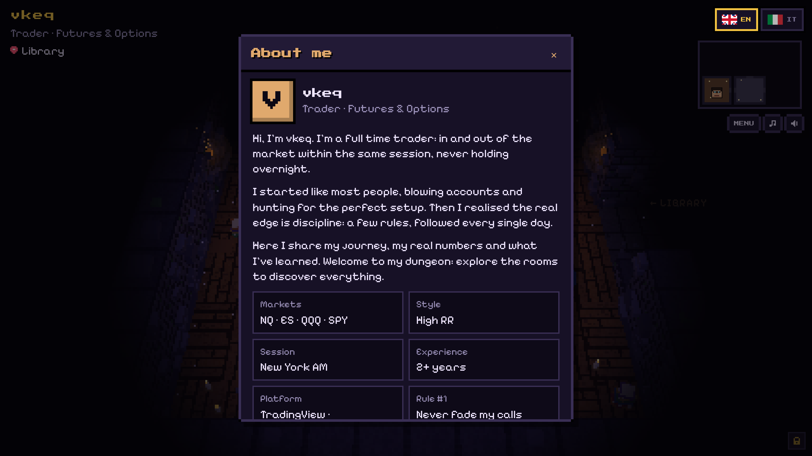
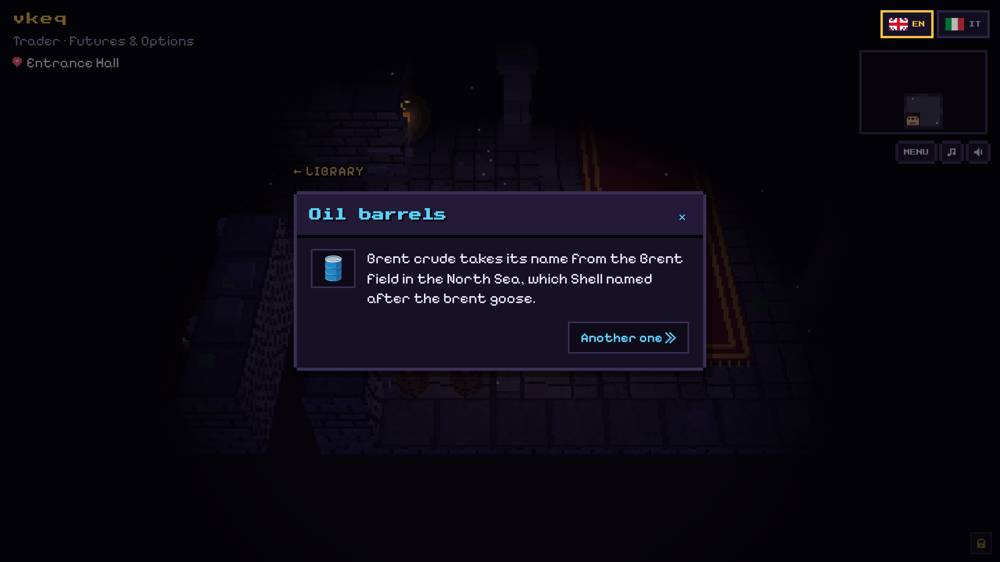

  

# vkeq's dungeon

**vkeq's dungeon** is the personal website of vkeq, a futures & options trader, built as a small
dungeon crawler. There are no pages to scroll: you walk a little voxel trader, in a suit and shades, through
torch-lit stone rooms. Every room keeps a piece of the keeper's world: who vkeq is, the trading style, the
numbers and the socials. Along the way, barrels, gold and old books hide short stories from market history.

The whole dungeon is rendered in real-time 3D and drawn in chunky pixels. It plays in the browser on desktop
and mobile, in English or Italian, with its own synthesised cave ambience.

**Enter the dungeon → [vkeq.trade](https://vkeq.trade)**

## The map

  

### I · The Entrance Hall

Every visitor wakes up here. Torches hiss along the walls and a frayed red carpet points north, towards a glint
of gold. Four cracked pillars hold up the dark, and a notice board greets the newcomers. In the corners, old oil
barrels and supply crates still smell of the trading pits, and they will tell their stories to anyone who knocks.

### II · The Library

West of the hall: dust, candle wax and old paper. One great shelf and one crooked little one sag under trading
books, potions and the odd skull. On the lectern lies an open book in the keeper's own hand. In the corner, a
forgotten trading desk still flickers with red and green candles, while a globe turns slowly on its own.

### III · The Treasure Room

Beyond the northern corridor lies the hoard. A golden bull and a golden bear glare at each other across a royal
rug, coins spill across the floor, and on the far wall a chart keeps moving even when nobody is watching. In the
middle sits the great chest: open it and the keeper's record pours out, with profit, win rate and every payout.

### IV · The Portal Room

To the east the floor turns to violet crystal. A stone arch hums around a spiralling portal, with runes burning
along its pillars. Three crooked altars hold floating sigils, each one a gateway to the keeper's world beyond
the dungeon.

## How to explore

| | Desktop | Phone / tablet |
| --- | --- | --- |
| Walk | <kbd>W</kbd> <kbd>A</kbd> <kbd>S</kbd> <kbd>D</kbd> or arrow keys, or click the floor | Tap the floor |
| Run | Hold <kbd>Shift</kbd> | — |
| Interact | Walk up to an object and press <kbd>E</kbd> / <kbd>Space</kbd>, or click it | Tap the object or the **A** button |
| Jump to a room | **MENU** (or <kbd>M</kbd>) | **MENU** |
| Close a panel | <kbd>Esc</kbd> or ✕ | ✕ |

- **The notice board** opens as soon as you enter and explains everything.
- **Your torch** only lights the area around you, so walk into a room to discover what is inside.
- **The minimap** (top right) fills in as you explore. Your own pixel face shows where you are.
- **Glowing objects** open panels: the book (about me), the chest (performance), the portal and altars (socials).
  Barrels, crates, gold, shelves and the PC tell a different market anecdote every time.
- **Pixel flags** (top right) switch between English and Italian. Two small buttons toggle music and sound effects.

### Highlights

<table>
  <tr>
    <td width="50%"> <b>The gate.</b> Press Enter or tap to start.</td>
    <td width="50%"> <b>The notice board.</b> How to play, shown on arrival.</td>
  </tr>
  <tr>
    <td> <b>Portal Room.</b> Floating sigils lead to the socials.</td>
    <td> <b>Treasure Room.</b> Walk up to the chest.</td>
  </tr>
  <tr>
    <td> <b>The chest opens.</b> P&amp;L, win rate, equity curve and payouts.</td>
    <td> <b>The keeper's book.</b> Who vkeq is and how vkeq trades.</td>
  </tr>
  <tr>
    <td> <b>Market lore.</b> Knock on a barrel for a story about oil.</td>
    <td> <b>The full map.</b> Four rooms, three corridors, one keeper.</td>
  </tr>
</table>
